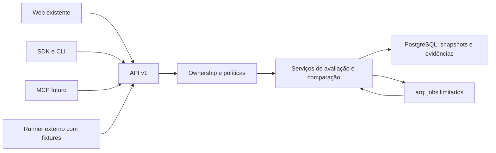

# Evolução incremental da arquitetura

Status: **proposta**, 2026-11-09. Nenhum contrato novo deste diretório está implementado. Base e limitações: [auditoria](../audits/estado-real-2026-11-09.md). Contratos normativos: [SPECs](../specs/README.md).

## Decisões arquiteturais

### ADR-001 — Núcleo compartilhado, sem apagar semântica

Contexto: EvaluationRun exige trace/rubrica; scores são 0–1. Opções: generalizar tabelas atuais com muitos campos nulos; converter predições em traces LLM; adicionar avaliação de tarefa ao lado do mecanismo de rubricas. Escolha: terceira opção. `TaskEvaluation` é execução agregada sobre snapshot/predições; `EvaluationRun` continua avaliação de trace. Um read model de avaliações expõe ambos com discriminante. São dois escopos de avaliação, não dois motores de autorização/filas. Modelos, datasets e evidências são comuns. Custo: união de leitura; benefício: compatibilidade sem falsificar mensagens ou scores. Revisar quando contratos reais mostrarem duplicação de lifecycle.

### ADR-002 — Snapshot materializado e métricas tipadas

Reusar Dataset/DatasetItem como área de edição. Materializar versões imutáveis em snapshot; resultados nunca leem itens vivos. Adicionar fatos de métricas com unidade, direção, validade e população; não usar `EvaluationScore` para MAE. Rejeitado EAV universal sem schema. Introduzir apenas tipos declarados e JSON validado para matriz/curva. Hash canônico não comprova qualidade do label. Revisar armazenamento após benchmark de 10 mil amostras e retenção.

### ADR-003 — Referências de modelos e aplicações leves

`ModelVersion` identifica artefato/provider revision; não serve nem treina modelo. Aplicação é composição versionada de código, configuração, modelos e adaptador; agente é aplicação que decide ações/ferramentas. Primeiro armazenar application manifest em Execution; tabela de catálogo de aplicações só quando descoberta/reuso exigir. Rejeitado registry completo próprio. Aliases externos resolvidos e fixados no início; sem revisão verificável marcar proveniência parcial.

### ADR-004 — API como fonte de verdade

FastAPI e serviços de domínio atendem web, SDK, CLI e MCP. Estender `ownership.py`, `deps.py` e chaves existentes com principal de serviço; nenhum JWT pessoal permanente. Web mantém Server Actions como cliente. CLI cliente JSON no MVP; MCP adapter posterior, sem DB direto. Rejeitado chat obrigatório. Revisar transporte MCP/OAuth apenas na implementação, contra documentação vigente.

### ADR-005 — Offline antes de execução remota

MVP importa predições numéricas já produzidas; não carrega pickle, código, URL livre ou pesos. Runner externo opt-in executa aplicação em ambiente do cliente, recebe lease limitado e devolve evidências; API não executa scripts enviados. Adaptadores locais e de agentes depois, com fixtures e rede bloqueada por default. Rejeitados sandbox genérico/GPU scheduler nesta fase. Replay atual permanece `llm_call`, sem promessa comportamental.

### ADR-006 — Decisão explícita e revisão humana

Estado de execução, validade da métrica e decisão de qualidade são eixos distintos. `inconclusive` é resultado legítimo. Juiz é evidência com versão e calibração, não label verdadeiro. Extender gate de tarefa em serviço/política própria sem mudar cálculo do gate de produção atual. Aprovação humana não reescreve score. Revisar critérios após piloto, mantendo histórico.

## Fluxo proposto

No MVP, TaskEvaluation é síncrona e limitada; Queue continua atendendo operações existentes. Contrato admite `queued` quando runner for introduzido, sem afirmar que já existe. Artefatos pequenos ficam em armazenamento privado configurado, usando padrão de exports; object storage só após volume medido. Conteúdo nunca é servido por caminho fornecido pelo cliente.

## Compatibilidade e modularização

Preservar `/v1/evaluations/run`, batch, experiment run, rerun, SDK tracer, rubricas e QualityGateConfig. Criar rotas aditivas com schema_version; não mudar silenciosamente experimentos existentes para executar modelo real. `Experiment.kind=legacy_synthetic|task_comparison` permite relaxar dataset/rubric somente para novo tipo, com constraints condicionais e serializer legado preservado. `ExperimentRun` continua execução de comparação, ligada a TaskEvaluations por variante. Não introduzir segundo catálogo de datasets ou feedback duplicado por trace.

Proposta de módulos: `domain/task_evaluations`, `domain/metrics`, serviços de snapshots/comparação e runner; arquivos finais seguem convenção local. Migrations futuras usam expand/backfill/constraints, preservando IDs e revisão Alembic única. Rollback operacional desabilita escrita nova, preserva fatos, restaura leitor anterior; downgrade destrutivo não é plano de rollback.

## Questões abertas com recomendação

| Questão | Opções e recomendação | Prova antes de ampliar |
|---|---|---|
| Biblioteca numérica | stdlib para MAE/MSE/RMSE/R²; scikit-learn isolado para classificação avançada | validar fixtures contra referência fixada; medir custo de dependência antes de adicionar |
| Escala de artefatos | diretório privado existente vs object storage | iniciar pequeno; medir concorrência/replicação antes de distribuição |
| Identidade externa | referência declarada vs artefato verificável | aceitar declarada com `provenance=partial`; exigir digest para equivalência estrita |
| Runner hospedado | infraestrutura cliente vs sandbox gerenciado | começar no cliente; piloto de isolamento antes de hospedagem |
| MCP auth | adapter local com chave vs remote OAuth | local primeiro; fixar protocolo e ameaças antes de remote |

Decisões acima são recomendações documentadas no escopo autorizado, sem alegar validação de mercado. Não bloqueiam a redação nem autorizam implementação.
